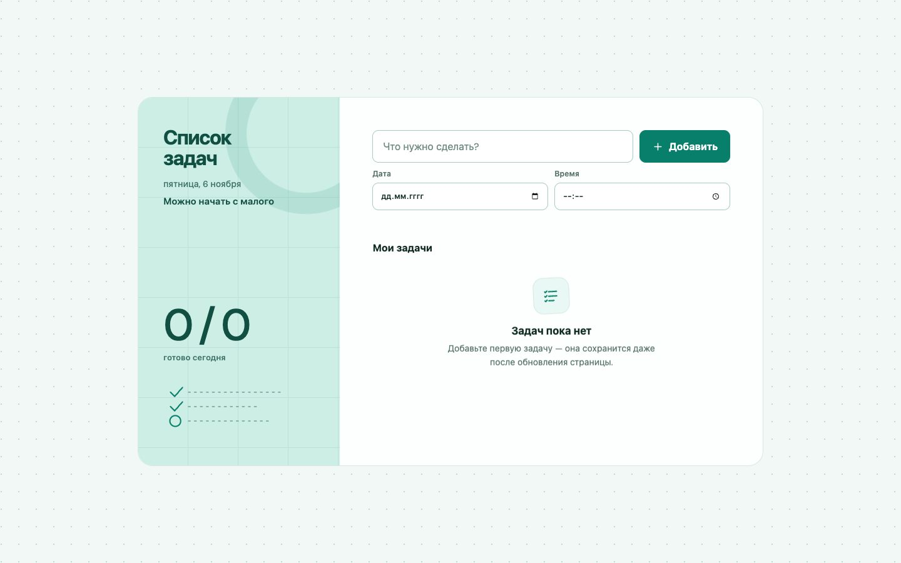

# Focus List

Небольшой адаптивный планировщик задач без фреймворков и серверной части. Данные хранятся локально в браузере, поэтому список сохраняется после обновления страницы.



## Возможности

- создание, редактирование и выполнение задач;
- планирование по дате и времени с индикацией просроченных задач;
- фильтры «Все», «Активные» и «Выполненные»;
- подтверждение удаления и возможность вернуть задачу в течение пяти секунд;
- сохранение данных в `localStorage`;
- адаптивная вёрстка, клавиатурная навигация и поддержка `prefers-reduced-motion`.

## Запуск

Проект не требует установки зависимостей:

```bash
python3 -m http.server 4173
```

Откройте [http://localhost:4173](http://localhost:4173).

## Тесты

Нужен Node.js 18 или новее:

```bash
node --test task-utils.test.mjs
```

## Структура

- `index.html` — семантическая разметка интерфейса;
- `styles.css` — адаптивная визуальная система и анимации;
- `app.js` — состояние и взаимодействие с DOM;
- `task-utils.mjs` — чистые функции нормализации, фильтрации и работы со сроками;
- `task-utils.test.mjs` — модульные тесты критичной логики.

## Ограничения

Задачи сохраняются только в текущем браузере и не синхронизируются между устройствами.

